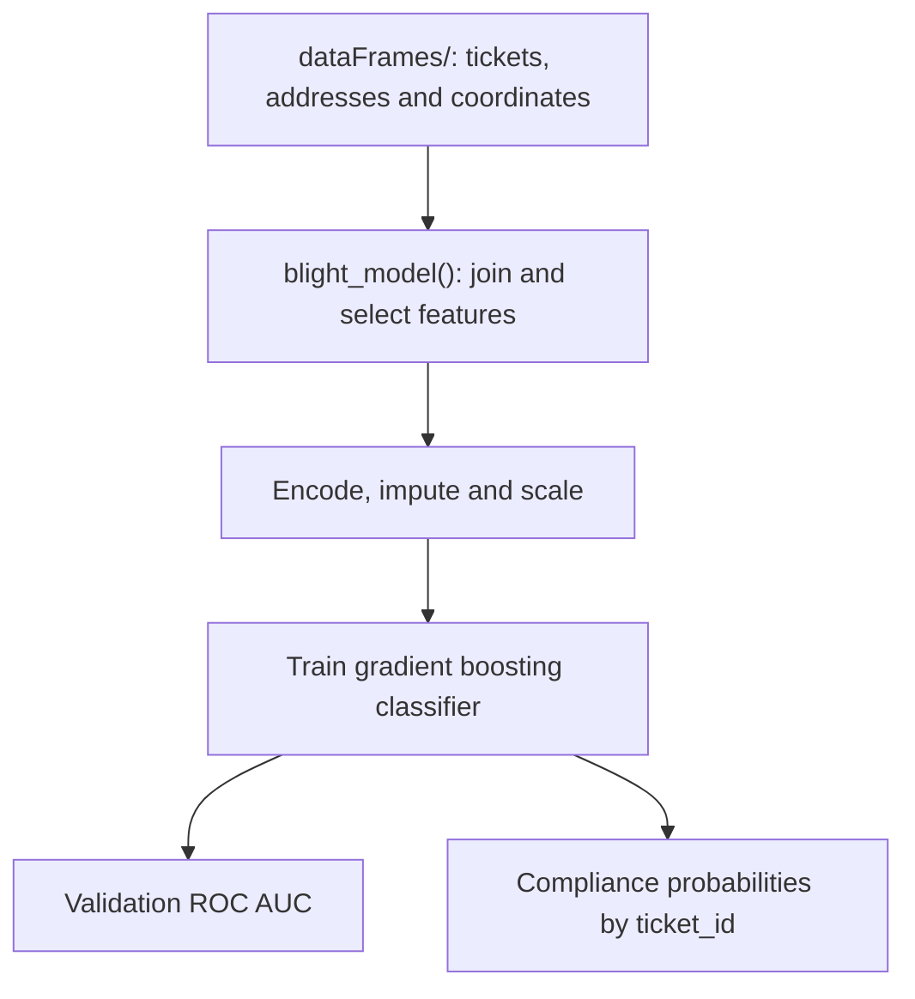

# Detroit blight ticket compliance prediction in Python

A machine learning project that estimates whether a Detroit blight ticket will be paid on time. It uses pandas and scikit-learn to combine ticket records with location data, prepare features and train a gradient boosting classifier.

The project was developed for the [Detroit Blight Ticket Compliance challenge](https://www.kaggle.com/c/detroit-blight-ticket-compliance).

## How the model works

[blightModel.py](blightModel.py) removes records without a compliance label and excludes payment-related fields that would reveal the outcome. It joins addresses and coordinates, then uses eight features: postcode, violation code, fine amount, discount amount, latitude, longitude, disposition and late fee.

Categorical encoding, mean imputation and min-max scaling prepare the inputs. A `GradientBoostingClassifier` uses 50 estimators, a learning rate of 0.5 and `random_state=0`.



## Running the original code

The project uses Python, pandas, NumPy and scikit-learn. Its original dependency versions are not recorded.

Two compatibility details need attention before running:

- The code imports the legacy `sklearn.preprocessing.Imputer`. This requires an older compatible environment or a code update to `SimpleImputer`; see the [scikit-learn deprecation note](https://scikit-learn.org/0.21/modules/generated/sklearn.preprocessing.Imputer.html).
- The CSV files are stored in [dataFrames/](dataFrames/), while the script reads `dataframes/`. On a case-sensitive filesystem, make that path available locally or adjust the four CSV paths.

Once those are resolved, run from the repository root:

```bash
python main.py
```

The script prints the validation ROC AUC. To keep the predictions, call the function directly:

```python
from blightModel import blight_model

predictions = blight_model()
print(predictions.head())
```

It returns a pandas Series named `compliance`, indexed by `ticket_id`. The included [main.py](main.py) does not save a submission file.

## Recorded results and limitations

The original project reported a local ROC AUC of **0.8147** and a university autograder AUC of **0.776**. These are historical results.

Preprocessing needs further work: imputation is fitted before the validation split, and encoders and imputers are fitted separately on training and submission data. A future revision should fit preprocessing on the training split and reuse it consistently.

## Licence

[MIT](LICENSE.txt).
